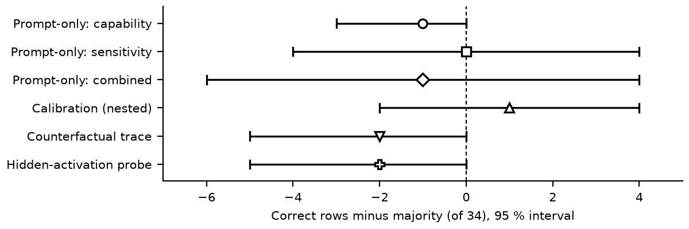

# Six robustness signals, none clearly better than the majority baseline: five missed their gates, four of them on 34 labelled rows

**Team:** exochard · **Tracks:** Main and Small Models

*Technical report for the AIMO Interpretability Challenge writeup awards. Negative result.*

## Abstract

Do signals read from a model predict whether its accuracy survives perturbation on problems it has
not seen? We tested six: prompt-only features, ability and difficulty calibration, generation
stability, counterfactual trace sensitivity, a hidden-activation probe and forced-answer flips.
With whole problems held out, the five gated signals missed their gates, the sixth had no gate. Three
intervals in the Section 4 table span zero and three end at exactly 0; none lies wholly above zero. A 43-row refit on the newer file agrees.
Generation stability and forced-answer flips have no interval. Labels are nearly uniform across models for a given problem, so a method
can look good by recognising problems (a lookup gains 0.20 to 0.33 balanced accuracy under a row split), and the training labels are about 71 % robust while the
public sets are near balance. We report the negative result with its gates, intervals and code.

## 1. Summary

We ask whether robustness signals generalise to problems a model has not seen, on the small-track
training labels: 34 (model, problem) configurations over 20 problems and four models (Qwen3.5-4B,
Skywork-OR1-Math-7B, Olmo-3-7B-Think, DeepSeek-R1-0528-Qwen3-8B).

1. **Robustness is mostly a property of the problem** (Lesson 9). In the 2026-10-15 label file, 13
   of the 14 problems labelled for several models carry one label for every model (11 of 11 at the
   pinned snapshot), against 4.8 expected under a label shuffle (2,000 permutations, 95 % range 2
   to 8). A split by row leaks the problem, so every headline result holds out whole problems.
2. **Prevalence differs between training and public sets** (Lesson 6). 24 of the 34 configurations
   are robust, so always answering "robust" scores 0.706 here, against 0.48 on the public main set
   and 0.50 on the small set. We report balanced accuracy beside accuracy.

None of the six signals showed transfer to unseen problems. The five gated signals did not clear
their gates; calibration came closest at 25/34 against a majority of 24 (balanced accuracy 0.579,
interval −2 to +4 rows; −1 of 43 on the newer file). Generation stability had no gate and nearly constant agreement features, so it is a weak test
(Appendix B.2). Calibration's interval still leaves a true gain of up to four of 34 configurations
(12 points of accuracy) unexcluded. Results use the 82-row snapshot of `train-main-v2` (pinned
revision `23791d9b`; Appendix B.3). The entry makes no White-Box claim: no dedicated ablation was run.

## 2. Data and protocol

Labels follow the organisers' rule: robust when the largest accuracy drop across perturbation
families is at most 0.10, non-robust from 0.25; the band between is unlabelled. Each problem
contributes up to four rows (one per model), so a split by row would leak the problem. Every
result below except the family holdout holds out whole problems (outer folds). Feature standardisation
is fitted on the outer training rows only. The calibration, trace and activation probes also choose their penalty (and carry
per-model terms) there; the prompt-only probe uses a fixed C = 1, with no model term. We also report a family holdout (train on three models, predict the fourth); it leaks problems, since labels agree across models, and the leak favours the method (Appendix B.2). The 34 labelled rows are Qwen3.5-4B 12, DeepSeek-R1-0528-Qwen3-8B 10, Olmo-3-7B-Think 9
and Skywork-OR1-Math-7B 3, so the family holdout rests mostly on three families and the Skywork fold
is three rows. Every label comes from the organisers' `train-main-v2`; Lessons 6, 8 and 9 also read their augmented
DeepSeek sets and public sample. We made no labels of our own, and the organisers retired the rule
against extra labelled data on 19 September (rules page, read 2026-10-17).

## 3. Methods

Each signal sees only what a deployed entry sees: the prompt, or the model's own generations on it.
Details are in Appendix B.4.

- **Prompt-only features.** One forward pass over the original prompt and two perturbed copies
  (typos, an irrelevant sentence) gives eight features (likelihood, length, changes in both,
  hidden-state shift), read by a logistic probe.
- **Calibration.** A per-model ability term and a per-problem difficulty term from prompt
  statistics; the arm is chosen inside each training fold.
- **Generation stability.** Qwen3.5-4B samples the original and perturbed prompts; answer agreement
  and accuracy drop are compared with the label's `max_drop`.
- **Counterfactual trace sensitivity.** A fixed 256-token reasoning prefix is teacher-forced under
  answer-preserving rewrites and one answer-changing control; eleven features measure the response.
- **Hidden-activation probe.** A ridge probe on native hidden states at 25, 50 and 75 % depth, over
  the prompt and a 128-token reasoning prefix.
- **Forced-answer flips.** Each model answers the original and three perturbed copies, with the
  final answer forced when unfinished; the share of changed answers is the signal.

Four of the five gates (all but flips) were committed before their results (Appendix B.1);
generation stability had none. "Short by" counts rows missing from the +3 margin over the gate's
own baseline.

| Signal | Gate as coded (all must hold) | Fixed in | Short by |
|---|---|---|---:|
| Prompt-only features | combined accuracy ≥ 0.80; correct ≥ better baseline + 3; margin > 0 after dropping any one problem | `8821dd5`, 2026-10-11 14:36; results 17:49 | 4 (23 vs 24) |
| Calibration | nested accuracy ≥ 0.80; correct ≥ prompt-probe control (23) + 3; no held-out family below its majority | `7ba8061`, 2026-10-11 19:53; results 21:22 | 1 (25 vs 23); 2 against majority 24 |
| Generation stability | none: it prints correlations and leave-one-out accuracy | no gate | not applicable |
| Counterfactual trace | accuracy ≥ 0.80; correct ≥ max(majority, calibration 25) + 3; balanced ≥ 0.70; margin > 0 after dropping any one problem | `8f7abe9`, 2026-10-13 12:04; rows 14:16 | 6 (22 vs 25) |
| Hidden-activation probe | coverage complete; accuracy ≥ 0.80; correct ≥ majority + 3 and ≥ calibration + 3; balanced ≥ 0.70; margin > 0 after dropping any one problem | `2c49bc8`, 2026-10-14 11:16; result 14:50 | 5 against majority 24; 6 against calibration |
| Forced-answer flips | held-out correct ≥ majority + 3 | `6303f85`, 2026-10-14 15:10; rows file 15:10 | 2 (52 vs 51 on 86 rows) |

## 4. Results

::: {.results}

| Signal | Correct / 34 | Balanced accuracy | Wins / losses vs majority | Difference [95 %] | 43 rows: correct, difference [95 %] |
|------------------------------|-------:|-------:|-------------:|-------------:|-------------:|
| Always "robust" | 24 | 0.500 | — | — | 31 |
| Prompt-only: capability | 23 | 0.479 | 0 / 1 | −1 [−3, 0] | 30, −1 [−3, 0] |
| Prompt-only: sensitivity | 24 | 0.558 | 2 / 2 | 0 [−4, 4] | 28, −3 [−8, 1] |
| Prompt-only: combined | 23 | 0.567 | 3 / 4 | −1 [−6, 4] | 29, −2 [−9, 5] |
| Calibration (nested selection) | 25 | 0.579 | 2 / 1 | +1 [−2, 4] | 30, −1 [−3, 0] |
| Counterfactual trace sensitivity | 22 | 0.458 | 0 / 2 | −2 [−5, 0] | 30, −1 [−4, 2] |
| Hidden-activation probe | 22 | 0.458 | 0 / 2 | −2 [−5, 0] | 29, −2 [−5, 0] |

:::

The first five columns use the same 34 labelled configurations; wins are rows a signal gets right
where the majority is wrong, losses the reverse. The last column refits all six on the 43 labelled
rows of the 2026-10-15 file (22 problems, majority 31; `report/intervals-43.json`): none beats the
majority and every gate fails again. Intervals come from 10,000 bootstrap resamples of whole
problems (`report/intervals.py`); none lies wholly above zero.

Post hoc (Appendix B.2), no signal's held-out AUC interval lies above 0.5; calibration's is
0.67 [0.45, 0.95], and at a prior-matched threshold it gets 24/34, the majority's count.

- **Calibration** falls to 22/34 under a leaking family holdout (balanced 0.604; Appendix B.2).
- **Generation stability** (12 labelled rows, no gate): the largest Spearman correlation with
  `max_drop` is 0.24 (p = 0.46); the best leave-one-out rule, chosen after the fact from 13, gets 9/12
  against a majority of 8/12.
- **Counterfactual trace sensitivity:** 22/34; the leaking family holdout reached 24/34, equal to its majority.
- **Forced-answer flips:** 52/86 against a majority of 51/86 (Lesson 8).

## 5. What we learned

1. **The sample is smaller than it looks.** 34 rows from 20 problems give about 20 independent
   units, and the Section 4 intervals are 3 to 10 configurations wide.
2. **Neither prompt features nor hidden states beat the majority** (Section 4).
3. **Sensitivity of a fixed trace is not sensitivity of the answer.** The answer-changing control
   moved the likelihood more in 25 of 32 traced configurations, yet the contrast did not separate labels.
4. **Local models are a proxy for the official deployments** (Lesson 4); a limitation, not an explanation.
5. **The label is about perturbations of solved problems, and nearly every row is solved.** In the
   organisers' two DeepSeek sets, 52 of 54 and 138 of 141 rows have base accuracy 1.0, and 79 % and
   74 % of those are non-robust (Lesson 6).
6. **Answer-level tests run out of token budget.** DeepSeek-R1-0528-Qwen3-8B gave no final answer
   within 4,096 tokens on 36 of 36 samples (Lesson 7).
7. **Forcing the final answer does not rescue the answer-level test.** The flip-rate AUC is 0.71
   [0.44, 0.87] on the 34 train-file rows (not the Section 2 set) and 0.40 [0.22, 0.59] on the
   organisers' per-permutation labels; the difference, 0.30 [−0.01, 0.54], includes zero, and label
   source and model could not be separated; on the 12 surface-only rows (4 robust) it is 0.55,
   underpowered. The held-out rule scores 18 of 34 against a majority of 24 (Lesson 8).
8. **Robustness behaves like a property of the problem** (Lesson 9). Five of the ten public sample
   problems have labels in `train-main-v2`, so a lookup can inflate public scores. Holding out one
   row instead of the whole problem lets a same-problem lookup gain 4 of 34 rows (one problem) and 8
   of 43 (three problems) over the majority, balanced accuracy +0.20 [0, 0.40] and +0.33 [0, 0.46];
   the length, prompt-only and calibration fits gain at most two rows under that split, so the strict
   split does not explain their nulls (Appendix B.3; repeated-subject leakage, Related work).

**The organisers' artifact on our labels.** The uncertainty-profiling artifact shipped in both
hybrids, run once with its own estimator and threshold on the 10 DeepSeek rows of the newer file (10
problems, 7 robust), gets 2 of 10 against a majority of 7 (balanced 0.33; −5 rows [−10, 0]); it calls
9 of 10 rows non-robust. Its README reports balanced accuracy 0.6262 on the organisers' 141-row
DeepSeek set, where always answering "non-robust" scores 0.745, and four text-length features reach
0.64 there under problem-grouped folds (Appendix C).

## 6. Reproduction

Code, saved features and commands: https://github.com/exochard/aimo-interp-report, also attached as
`aimo-interp-report.zip` with `MANIFEST.sha256`, under Apache-2.0. `REPRODUCE.md` recomputes
Sections 1 to 4 on a CPU in about three minutes from the saved features and the data files of Appendix D. The v2 bundles in
`dist/entry/` were built and not uploaded; the competition entries are the v1 uploads of Appendix A.

## Related work

Our signals follow work on predicting a model's own reliability. Kadavath et al. (2022) had models
predict whether they will know the answer, the idea behind our prompt-only features. Kuhn, Gal and
Farquhar (2023) take the entropy of meaning clusters of sampled answers; our stability signal
compares only final answers. Azaria and Mitchell (2023) probe hidden states with labels, as our
activation probe does; Burns et al. (2023) do so without labels. Our perturbations follow Shi et
al. (2023) on irrelevant context (our distractor sentence) and Mirzadeh et al. (2024), whose
GSM-Symbolic varies names and numbers (our renaming variants). Written chain-of-thought can misreport
what drove an answer (Turpin et al., 2023; Lanham et al., 2023), so our trace signal scores how a
fixed reasoning prefix responds to edits, not what the reasoning says. Train and test rows from the
same subject inflate predictions, more so in small samples (Kapoor and Narayanan, 2023; Rosenblatt
et al., 2024); our repeated problems resemble those subjects.

## Limitations

Generation stability (12 rows) and forced-answer flips (86 rows) were scored on their own row sets,
not in the Section 4 table. The 34-row sample gives about 20 independent problems. Local models
are a proxy for the official deployments (Lesson 4). No white-box ablation was run. The Olmo-3-7B-Think forced-answer run was stopped (Appendix B.1). On power: 34 rows from about 20 problems cannot exclude a true
gain of up to four rows (12 points) over the majority.

## AI-assistance statement

AI models did the work under the entrant's direction: Claude (Anthropic, through Claude Code)
designed and wrote the code, ran the analyses and drafted this report; OpenAI Codex helped plan and
review. The entrant set the goal, approved each upload and answers for the submission. Every
number was rerun from the scripts named above, except Lesson 7 (36 of 36 samples without a final
answer), whose outputs were not kept, the Olmo progress count read from its log, and the Codabench scores, ids and board ranks of Appendices A
and D, which were read from the competition pages and the funnel log and have no script.

## References

- Azaria, A., Mitchell, T. (2023). The Internal State of an LLM Knows When It's Lying. Findings of
  EMNLP 2023.
- Burns, C., Ye, H., Klein, D., Steinhardt, J. (2023). Discovering Latent Knowledge in Language
  Models Without Supervision. ICLR 2023.
- Kadavath, S., et al. (2022). Language Models (Mostly) Know What They Know. arXiv:2207.05221.
- Kapoor, S., Narayanan, A. (2023). Leakage and the Reproducibility Crisis in Machine-Learning-Based
  Science. Patterns, doi:10.1016/j.patter.2023.100804.
- Kuhn, L., Gal, Y., Farquhar, S. (2023). Semantic Uncertainty: Linguistic Invariances for
  Uncertainty Estimation in Natural Language Generation. ICLR 2023.
- Lanham, T., et al. (2023). Measuring Faithfulness in Chain-of-Thought Reasoning.
  arXiv:2307.13702.
- Mirzadeh, I., et al. (2024). GSM-Symbolic: Understanding the Limitations of Mathematical
  Reasoning in Large Language Models. arXiv:2410.05229.
- Rosenblatt, M., et al. (2024). Data Leakage Inflates Prediction Performance in Connectome-Based
  Machine Learning Models. Nature Communications, doi:10.1038/s41467-024-46150-w.
- Shi, F., et al. (2023). Large Language Models Can Be Easily Distracted by Irrelevant Context.
  ICML 2023.
- Turpin, M., Michael, J., Perez, E., Bowman, S. R. (2023). Language Models Don't Always Say What
  They Think: Unfaithful Explanations in Chain-of-Thought Prompting. NeurIPS 2023, arXiv:2305.04388.
- AIMO Interpretability Challenge organisers. getting-started kit,
  github.com/aimo-interp/getting-started, commit `de79405`.

## Appendix A. Submission history

Every upload to the competition, in order. Hashes are of the zips in the
lane's `dist/`, all of which the archive ships (`dist/entry/`, `dist/probe/`, and the two constant baselines); full hashes are in `REPRODUCE.md`.

| File | sha256 (first 16) | Uploaded | Task | Id | Public score |
|---|---|---|---|---:|---:|
| `always-true-main.zip` | `ba38cb0e7b55dd3a` | 2026-10-11 | main | 977178 | 0.48 |
| `always-true-small.zip` | `a3748c648a5a0d9a` | 2026-10-11 | small | 977183 | not recorded |
| ten single-configuration probes, `probe/*.zip` (nine zips kept) | see `REPRODUCE.md` | 2026-10-18 | both | not recorded | main best 0.57, small best 0.57 |
| `main-hybrid-v1.zip` | `d2df7dc8a0daaf85` | 2026-10-19 | main | 1002314 | 0.57 |
| `small-groups-v1.zip` | `82344d44e9b9d86e` | 2026-10-19 | small | 1002316 | 0.64 |
| `small-hybrid-v1.zip` | `376c170a05b963c8` | 2026-10-19 | small | 1002317 | unscored |

The two constant baselines answer "robust" for every configuration. The funnel notes that the
first `always-true-small` upload had gone to the main task and was rejected at ingestion, so
its small-task score is not recorded; the small public set is 50 % robust.

The probes each answered "robust" for one model configuration and non-robust for the rest. Their
net robust counts on the public sets (score times problems, minus the all-non-robust score) were,
main: Qwen3.5-4B 0, Olmo-3-7B-Think 0, DeepSeek-R1-0528-Qwen3-8B -1, gpt-oss-120b low -1,
gpt-oss-120b medium +1 (0.57), Skywork pending (cancelled); small: Qwen3.5-4B +1 (0.57), Skywork -1,
Olmo -1, DeepSeek +1. The small-track DeepSeek +1 is derived from the funnel's total, not a measured
score. The main-track DeepSeek probe was cancelled on 2026-10-19 (the funnel lists -1 for it, with no
final score), and `small-hybrid-v1` has no recorded score. The public sets are 21 main and 14 small problems, so counts of +/-1 are
noise-sized, as the funnel notes itself; the selected groups are chosen by those counts and can be
overfit to the public sets. `small-groups-v1` answers "robust" for Qwen3.5-4B and DeepSeek
(public 9/14 = 0.64, the sum of the two probes' counts, one of them derived). `main-hybrid-v1` answers "robust" for
gpt-oss-120b at medium effort only. Both hybrids replace DeepSeek's answer by the prediction of the
organisers' bundled uncertainty-profiling artifact (`uncertainty_profile/`, run on DeepSeek's own
greedy trace); the small hybrid also keeps Qwen3.5-4B robust. That artifact is not one of the six
signals tested above; scored afterwards on 10 of our rows, it got 2 against a majority of 7 (Section 5). On the public main set the hybrid scored
0.57, the same as the gpt-oss-medium probe alone. None of these entries uses a signal that
cleared its gate; they are public-set group choices. Guarded v2 hybrids (`entry/`, built by `entry/build.sh`)
were built and not uploaded.

### Submission bundle (v2 hybrids)

Each zip holds a `solution.py` that answers per (model, reasoning effort) group. Groups in `ROBUST`
get "robust"; all others get "non-robust"; DeepSeek-R1-0528-Qwen3-8B gets the organisers' artifact
prediction. The two tracks differ only in these constants and the root-level `small.txt` marker the competition
requires in a small-track zip and forbids in a main-track one (kit README; zip sha256, first 16:
small `b6d1e6e363c554f8`, main `39d1752a8d6d8fe1`):

| Track | `ROBUST` | `FALLBACK` | `CHUNK` | `DEADLINE_S` | `MARGIN_S` | `small.txt` |
|---|---|---|---:|---:|---:|---|
| small | `("Qwen/Qwen3.5-4B", "*")` | True | 8 | 3000 | 300 | present (1 byte) |
| main | `("openai/gpt-oss-120b", "medium")` | False | 8 | 3000 | 300 | absent |

The artifact runs on 8 problems at a time. Before each chunk it stops if the time since import
exceeds `DEADLINE_S` (overridable by `AIMO_DEADLINE_S`), or if the elapsed time plus 1.5 times the
slowest chunk so far would pass the 3,600 s run limit less `MARGIN_S`. Every remaining DeepSeek
problem, and every problem after an error, gets `FALLBACK`. This early stop reads the wall clock, so
a slow host can change predictions. The zip hash identifies the shipped file; the build is not
byte-reproducible.

## Appendix B. Methods, results and gates in full

### B.1 Gates

The gates are in the table in Section 3.

"Set before it ran" rests on git commit times against file times of untracked, unsigned run files,
and holds only for the prompt, calibration, trace and activation gates. For the first flips run it
cannot be shown: its rows file is stamped 25 s before the gate's commit (the gate line is
unchanged since). That run was unforced and gave no result: DeepSeek-R1-0528-Qwen3-8B produced no
final answer within 4,096 tokens on 36 of 36 samples (Lesson 7), and it was stopped. The reported
52/86 run came three days later with the final answer forced. Its Olmo-3-7B-Think job was stopped at
24 of 108 prompts (`runs/force-r4/Olmo-3-7B-Think.log`), so no Olmo row enters the flip test; Olmo
has 9 labelled rows. Calibration's control of 23 was the
prompt probe's own result, already known when its gate was committed.

**Prevalence.** A count that beats a 71 %-robust majority says little about a near-balanced private
set, so the table reports balanced accuracy (any constant answer scores 0.500). The trace and
hidden-activation gates also required balanced accuracy of at least 0.70; those two probes reached
0.458, and no nested-selection result in the table exceeds 0.579 (the descriptive arm in B.2 reaches 0.60). `report/balanced_gates.py` prints these values from
the saved reports. The forced-answer test saved no held-out predictions; its majority class is
non-robust (rows are 40.7 % robust), and it was 52/86 against 51/86.

### B.2 Results

- **Prompt-only features:** capability features 23/34 (balanced 0.479), sensitivity 24/34 (0.558),
  combined 23/34 (0.567). The gate needed at least three more correct than majority; the margin
  was -1, and -2 after dropping the worst problem group.
- **Calibration:** 25/34 (0.735, balanced 0.579) under nested problem holdout, one more than
  majority; the family holdout fell to 22/34 (balanced 0.604). The family holdout is not a
  held-out-problem test: the problems in the held-out family appear in training under the other
  models, and Lesson 9 shows their labels are nearly identical across models. The leak favours the
  method, and the figure still does not beat the majority of 24. The descriptive arm
  ability + difficulty + sensitivity, fitted as a fixed arm, reached 26/34 (balanced 0.60) and was
  chosen in 12 of 20 outer folds, but the pre-set nested selection gave 25/34.
- **Post hoc ranking** (not part of any gate; `report/posthoc_auc.py`, `report/posthoc_auc.json`).
  For each gated signal except forced-answer flips, the held-out score behind the table's
  prediction (same model, same training rows, same inner selection; each score cut at the model's own
  threshold reproduces the reported correct count). AUC has robust as positive, with a 95 % interval
  from 10,000 resamples of whole problems. The prior-matched cut predicts robust for the highest
  scores so that the predicted share equals the mean training-fold robust share (0.706, 24 of 34
  rows); ties at the cut all count as robust.

  | Signal | Held-out AUC, 95 % interval | Correct / 34 at the prior-matched cut | Correct / 34 reported |
  |---|---|---:|---:|
  | Prompt-only: capability | 0.43 [0.14, 0.89] | 22 | 23 |
  | Prompt-only: sensitivity | 0.57 [0.36, 0.82] | 18 | 24 |
  | Prompt-only: combined | 0.59 [0.32, 0.93] | 22 | 23 |
  | Calibration (nested selection) | 0.67 [0.45, 0.95] | 24 | 25 |
  | Counterfactual trace sensitivity | 0.39 [0.14, 0.64] | 20 | 22 |
  | Hidden-activation probe | 0.35 [0.17, 0.66] | 18 | 22 |

  Every interval includes 0.5. The pooled cut mixes scores from different folds, so it is
  descriptive only; the always-"robust" majority gets 24/34.
- **Generation stability:** on the 12 labelled Qwen3.5-4B rows, the largest rank correlation of
  any stability statistic with `max_drop` is Spearman 0.24 (p = 0.46, 12 rows; change in mean log-probability
  under the distractor; the 14 rows including the two unlabelled give 0.30, p = 0.30). The best leave-one-out threshold rule gets 9/12 (change in log-probability
  under typos, a different feature, the best of 13 chosen after the fact) against a majority of 8/12. In 10 of the 12 rows none of the four original samples
  reached a final answer within the 8,192-token cap, and the other two had one of four unanswered,
  so the agreement statistics are nearly constant. This signal had no predeclared gate.
- **Counterfactual trace sensitivity:** the pilot traced 37 configurations, the 34 labelled ones
  and 3 from the unlabelled band. Of the 34 labelled rows the probe is scored on, 31 had two or
  more verified variant families and 29 had the negative control; rows with a missing family or
  control enter with imputed values and a missing indicator. The probe reached 22/34 (balanced
  0.458), wrong on two rows the majority gets right and right on none it gets wrong; the family
  holdout reached 24/34, equal to its majority; the same leak applies to it.

- **Refit on 43 rows** (2026-10-15 file; `report/intervals-43.json`, `report/posthoc_auc-43.json`).
  Gates fail again: prompt-only margin −2; calibration out-of-fold accuracy 0.698, net −1 against
  the majority, 5 wins and 4 losses against its control; trace and hidden-activation probes do not
  pass. Balanced accuracy: 0.484, 0.477, 0.544 (prompt-only), 0.484 (calibration), 0.509 (trace),
  0.468 (activation). Post hoc AUC [95 %]: capability 0.468 [0.16, 0.87], sensitivity 0.570
  [0.34, 0.81], combined 0.629 [0.34, 0.93], calibration 0.460 [0.22, 0.76], trace 0.513 [0.35, 0.69].

### B.3 Row split and data snapshot

**Row split against problem split** (`report/split_audit.py`; `report/split-audit.json` for the 34
pinned rows, `report/split-audit-1015.json` for the 43 rows of the newer file). Split A holds out one
(model, problem) row and keeps that problem's other rows in training; split B holds out the whole
problem, as every headline result does. Features, train-only preprocessing and arms were fixed
before the run. The same-problem lookup predicts a row from the training rows with the same problem
text, else the fold majority; it demonstrates the leak and is not a method. Intervals come from
10,000 whole-problem bootstrap draws (seed 0), both splits rescored on each draw.

| Arm | 34 rows: correct A / B | balanced A − B | 43 rows: correct A / B | balanced A − B |
| --- | --- | --- | --- | --- |
| Majority | 24 / 24 | 0 | 31 / 31 | 0 |
| Four length features | 24 / 24 | 0 | 31 / 31 | 0 |
| Prompt-only combined | 23 / 23 | 0 | 31 / 29 | +0.03 [0, 0.07] |
| Calibration (nested) | 26 / 25 | +0.05 [0, 0.10] | 29 / 30 | −0.02 [−0.05, 0] |
| Same-problem lookup | 28 / 24 | +0.20 [0, 0.40] | 39 / 31 | +0.33 [0, 0.46] |

Under split A, 23 of 34 and 32 of 43 test rows have their problem in training. The lookup never
loses a row to the majority; every gain is a non-robust row, from one problem (34 rows) and three
problems (43 rows), so the lower bound sits at zero: 64 % and 96 % of draws are positive, none
negative. On 34 rows the length and prompt-only predictions are identical under both splits.
Calibration under split A keeps its inner search unchanged, which still holds out whole problems.
A label shuffle within each model, which keeps every model's robust rate, expects 3.9 agreeing
problems against 11 observed (34-row snapshot, all labelled models) and 4.9 against 11 on the small
track of the newer file; the pooled shuffle expects 3.8 and 4.7, and no shuffle of 2,000 reaches
the observed count in either. Model prevalence does not explain the agreement of Lesson 9.

The table keeps the 82-row snapshot of `train-main-v2` (pinned revision `23791d9b`), because gates
and features were frozen on it before the 2026-10-15 file existed. The newer file (94 rows) has 49
small-track rows, 43 of them labelled, over 22 problems, 31 robust; the 43-row refit uses it.

### B.4 Method details

**Prompt-only features.** One forward pass of the original prompt and of two surface
perturbations (typos, an irrelevant distractor sentence): prompt NLL and length, the change in NLL
under each perturbation, and the cosine change of hidden states at 50 % and 75 % depth. A
logistic probe over these eight features.

**Ability and difficulty calibration.** A per-model ability term and a per-problem difficulty term
estimated from prompt statistics, with covariates offered as arms (ability; +difficulty;
+covariates; +sensitivity) and the arm chosen inside the outer folds by inner leave-one-problem-out.

**Generation stability.** Qwen3.5-4B sampled on the originals and perturbed prompts; agreement and
accuracy drop between them, compared with the labels' `max_drop`.

**Counterfactual trace sensitivity.** A deterministic 256-token reasoning prefix is generated from
the original prompt. It is then teacher-forced after the original prompt and after verified
answer-preserving variants: variable renaming (with the rename applied inside the trace),
equivalent numeric expressions, equation-side swaps and reordering of independent givens. A
condition change that alters the answer (one integer constant raised by one) is the negative
control. Eleven predeclared features: the prefix's mean log-probability under the original prompt, the
per-token log-likelihood change (mean, worst family,
variance, concentration in the least likely 20 % of tokens), hidden-state cosine change at 50 %
and 75 % depth (also near renamed entities), the ratio of answer-preserving to answer-changing
sensitivity, and indicators for missing families and a missing control. Only trace positions are
captured, and activations are released per problem.

## Appendix C. Lessons in full

1. **The sample is smaller than it looks.** 34 rows from 20 problems give about 20 independent
   units. The Section 4 intervals are 3 to 10 configurations wide, so a real gain of one or two
   configurations could not be seen here.
2. **Prompt features did not beat the majority.** Capability features reached 23/34, sensitivity
   24/34 and the combined arm 23/34 against a majority of 24 (Section 4). One possible reason is that
   the label is a difference between two accuracies and a feature of one prompt sees only one side
   of it; we did not test this.
3. **Sensitivity of a fixed trace is not sensitivity of the answer.** The trace features measure a
   likelihood response, not whether the final answer survives the perturbation: teacher-forcing
   one reasoning prefix under a renamed or reordered problem measures surprise at the edit. The control that changes the answer moved the likelihood more in 25 of the 32
   traced configurations that have one (37 traced, 5 without a control; median ratio of
   answer-preserving to answer-changing change 0.61; on the 29 labelled rows with a control, 22 of
   29, median 0.62; `report/trace_control.py`), so the features see the edits; the contrast still did not separate the labels.
4. **Local models are a proxy for the official deployments.** Qwen3.5-4B ran in BF16; Olmo-3-7B-Think,
   DeepSeek-R1-0528-Qwen3-8B and Skywork-OR1-Math-7B ran in 4-bit NF4. Neither matches the
   organisers' serving setup, and the NF4 rows may carry quantisation effects in the trace
   features. We report this as a limitation, not as an explanation of the null result.
5. **Hidden states did not help either.** A linear ridge probe on each model's native hidden
   states (prompt and a 128-token reasoning prefix, pooled at 25, 50 and 75 % depth, families kept
   in separate coordinates) reached 22/34 under the same nested problem holdout, two below the
   majority (`fit_activation_probe.py`, `run_activation_probe.py`).
6. **The label is about perturbations of solved problems.** In the organisers' augmented sets,
   problems whose every base sample was correct are still mostly non-robust. The two sets are the
   same model, DeepSeek-R1-0528-Qwen3-8B (the kit's `uncertainty_profile/config.py` maps the id
   `qwen3-8b:low` to it), and all 52 problems of `augmented-sample-math-agg-filtered` also appear in
   `augmented-sample-math-agg` (137 problems), so the two figures are not two models. Rows are per permutation type, so a problem can appear in several rows: the filtered set has
   54 rows over 52 unique `problem_id`, the larger set 141 rows over 137. Rows with `base_accuracy`
   = 1.0 (any number of base samples, 1 to 60) are 52 of 54 and 138 of 141, nearly all rows, so the
   non-robust share among them (41 of 52, 79 %; 102 of 138, 74 %) matches the unconditional share
   (43 of 54, 80 %; 105 of 141, 74 %). Restricted to rows with exactly ten base samples: 34 of 40
   (85 %) and 63 of 82 (77 %). `report/lesson6_counts.py` computes all of these. Answer consistency
   on the original cannot be tested in these sets. The public evaluation sets are near balance
   (always "robust" scores 0.48 on the main task and 0.50 on the small-model task) while our 34
   labelled rows are 71 % robust (Section 1), so a majority vote learned on the training rows is
   not a safe default.
7. **Answer-level tests run out of token budget.** We started an answer-flip test (each model
   answers the original and typo, distractor and renamed copies). DeepSeek-R1-0528-Qwen3-8B
   produced no final answer within 4,096 tokens on 36 of 36 samples of the olympiad problems. This
   check is not reproducible from the archive: its outputs were not kept. We did not run the
   unforced test further; Lesson 8 forces the final answer instead.
8. **Forcing the final answer does not rescue the answer-level test.** We reran the answer-flip
   test with the final answer forced: each unfinished sample is continued from its reasoning with
   `</think>` and `The final answer is \boxed{` appended, greedy, 24 tokens. Rows: the
   2026-10-15 `train-main-v2` small-track labels (Qwen3.5-4B 12, Skywork-OR1-Math-7B 12,
   DeepSeek-R1-0528-Qwen3-8B 10; 34 rows, 24 robust) plus the 52 DeepSeek rows of the organisers'
   aggregated set `augmented-sample-math-agg-filtered` (11 robust); four samples per variant at
   2,048 tokens, Skywork and DeepSeek with FP8 weights. Under the same problem-held-out protocol
   the best rule reached 52/86 against a majority of 51/86, short of the gate.

   The sign of the signal differs between the two row sets, and the data do not tell label source
   from model apart: the two sets share no model except DeepSeek, and the DeepSeek train-file rows
   alone are 10 rows. `report/flips_by_source.py` joins the rows to their source and prints, for
   the AUC of the mean flip rate (above 0.5 means robust rows flip less) with a 95 % interval from
   4,000 bootstrap resamples of problem ids (seed 0):

   | Label source | Rows (robust) | Mean-flip AUC | 95 % interval | Problem-held-out rule, correct / majority |
   |---|---:|---|---|---:|
   | 2026-10-15 train file, Qwen3.5-4B | 12 (8) | 0.703 | | |
   | 2026-10-15 train file, Skywork-OR1-Math-7B | 12 (9) | 0.685 | | |
   | 2026-10-15 train file, DeepSeek-R1-0528-Qwen3-8B | 10 (7) | 0.738 | [0.12, 1.00] | |
   | 2026-10-15 train file, all | 34 (24) | 0.706 | [0.44, 0.87] | 18 / 24 |
   | Organisers' per-permutation set, DeepSeek | 52 (11) | 0.402 | [0.22, 0.59] | 41 / 41 |

   The difference, train file all minus organisers' set, is 0.304 [−0.01, 0.54].

   The train file labels a model on a problem by the largest accuracy drop over the perturbation
   families (Section 2). In the organisers' `augmented-sample-math-agg-filtered` (54 rows),
   `permutation_type` is a single type for 43 rows (32 `domain`, 59 % of all 54) and a list for 11
   rows (3 one-element `["distract"]`, 8 with two to five types). All 34 `domain` and `rephrase` rows are non-robust, so the 11 robust rows are among the other 20,
   while our typo, distractor and rename copies include neither permutation. Restricted to the 12 rows
   whose problem has only typos, distract or rename permutations in every one of its source rows (8 single-type rows, 4 list rows; 4
   robust), the mean-flip AUC is 0.547 [0.10, 0.89] (same 4,000-draw problem bootstrap,
   `--permutations`). With fewer than 5 robust rows the restricted test is underpowered and cannot say
   whether the sign reverses. The earlier pooled
   DeepSeek figure (0.348 on 62 rows) mixed both sources. On the competition-style labels the
   in-sample AUC is 0.71, but the held-out rule gets 18 of 34 against a majority of 24, so the
   null stands. The 52 augmented rows give 41 against 41, again no gain.
9. **Robustness behaves like a property of the problem, which makes public scores easy to
   inflate.** `report/lesson9_counts.py` computes these counts from the organisers' parquet files, and `report/lesson9_shuffle.py` the shuffle null.
   `train-main-v2` labels 33 problems. At the pinned revision (82 rows, `23791d9b`), 11 of them are
   labelled for more than one model and all 11 carry the same label for every model; counting
   each reasoning effort of gpt-oss-120b as its own configuration, 15 problems are labelled for
   more than one configuration and 14 of those agree. In the 2026-10-15 file used for the
   forced-answer test (94 rows), the figures are 14 of 33 with 13 agreeing by model, and 16 with
   15 agreeing by configuration. The rule that any model counts as a repeat is the loose one; the counts are small
   either way. On the small track alone the shuffle expects 4.7 agreeing problems (range 2 to 7).
   The one disagreement mixes a Skywork row with gpt-oss-120b rows, so it crosses tracks. Five of the ten problems in the public challenge sample appear in `train-main-v2`
   with labels (same count in both files). A lookup over labelled problems can therefore score
   well on public problems that overlap the training labels; we did not measure it on unseen private
   problems, and we read public scores far above the majority with that overlap in mind. Appendix B.3
   measures the same lookup on our labels under a row split and a shuffle that keeps each model's
   robust rate.

**The organisers' artifact, scored once on our labels.** The uncertainty-profiling example is not
one of the six signals; both hybrids ship it (Appendix A). `report/artifact_gate.py` generated
greedily with DeepSeek-R1-0528-Qwen3-8B on the 10 DeepSeek rows of the 2026-10-15 train file (10
problems, 7 robust; 4,096 new tokens; the kit's pinned library versions; most layers offloaded to the
CPU on a 12 GB card, which changes speed, and greedy tokens only through floating-point differences)
and applied the artifact's estimator and decision threshold unchanged (`runs/artifact-gate/score.json`).
It scores 2/10 against a majority of 7/10: balanced accuracy 0.333, difference −5 rows with a 95 %
whole-problem bootstrap interval of [−10, 0]. It predicts non-robust for 9 of 10 rows; both correct
calls are non-robust rows, and the probability that a robust row scores below a non-robust one is
0.14. Ten rows with three non-robust cannot measure its accuracy. They are consistent with a
threshold set where 74.5 % of rows are non-robust and applied to labels that are 70 % robust.

Its README documents a grouped out-of-fold balanced accuracy of 0.6262 and plain accuracy 0.6879
(`kit/solutions/uncertainty-profiling/README.md`, lines 127-128; DeepSeek only, on the organisers'
aggregated set). That is below this report's own 0.70 balanced bar, so by our standard it would not
clear a gate either. A constant "non-robust" scores 105/141 = 0.745 on that set, above the
artifact's 97/141. Our ten rows count against it, and the v2 bundles that use it were not entered.

   A length baseline (`report/length_baseline.py`) tests the 0.626 against problem length. On the
   same 141 rows (137 problems), five-fold problem-grouped folds, seeds 0 to 19, a standardized
   logistic regression with balanced class weights on four features of the problem text (log
   character count, word count, digit count, `$` count) reaches balanced accuracy 0.644 (0.592 to
   0.677) and accuracy 0.664; log character count alone reaches 0.698 (accuracy 0.702). A
   label-shuffle null (200 shuffles that permute labels across problems, rows of one problem kept
   together, one seed each) has median 0.498, 95th percentile 0.592 and maximum 0.647. The
   artifact's 0.6262 is not shown to beat problem length; its own folds and threshold differ from
   these, so the comparison is indicative.

   Transfer to the organisers' public sample (`report/sample_transfer.py`): labelling the 558-row sample by the Section 2 rule
   (largest `absolute_accuracy_decay` per model and problem, robust at most 0.10, non-robust from 0.25) gives 69 labelled
   (model, problem) pairs of 80 over 10 problems, 38 robust. Five of the 10 problems are also in `train-main-v2`, and only
   `gpt-oss-120b:low` and `qwen3-8b:low` (taken to be DeepSeek-R1-0528-Qwen3-8B) match a training configuration; the per-configuration prior
   predicts robust for both, so it scores 8 of 15 labelled pairs, the same as the pooled majority. The pooled per-problem arm needs
   features that do not exist for these problems (a GPU run), so it was not tested there.

## Appendix D. Reproduction details

Code, saved features and exact commands: https://github.com/exochard/aimo-interp-report, also attached as
`aimo-interp-report.zip` with `MANIFEST.sha256`, released under Apache-2.0 (`LICENSE` in the tree).
`REPRODUCE.md` recomputes the numbers in Sections 1 to 4 on a CPU in about three minutes from the
saved features and the data files below, and lists the data file, script and run folder behind each section; regenerating the
hidden-activation features needs a GPU. Data, all Hugging Face datasets of the organisation `aimo-interp`, none redistributed:

- `aimo-interp/train-main-v2` at revision `23791d9b120132087877b0459f953d5959fc8455`,
  `data/train-00000-of-00001.parquet`, sha256 `bedfb551ea0f4d95d5e70e1df7cf61395ce2d36eeba2869aba6a90fc3c198824`.
- `aimo-interp/train-main-v2` as of 2026-10-15 (`data/train-main-v2/train-2026-10-15.parquet`, 94
  rows), sha256 `e18eb44207e7987781ec2ff214793196038442bdc1466fdf5498f3e87ec58285`. No revision
  was recorded; the file is dated 2026-10-17 in the data folder.
- `aimo-interp/aimo-interp-challenge-sample-full` (the public sample of Lesson 9),
  `validation-00000-of-00001.parquet`, sha256 `2989ab6a018f2779a821209f414bd0049c9ef1c2488f589ff2d3bf4ed16942ff`.
  File dated 2026-10-11 in the data folder; no revision recorded.
- `aimo-interp/augmented-sample-math-agg` (Lesson 6), `validation-00000-of-00001.parquet`, sha256
  `b785750259a3f4524cbaf988f51660197cbdfca19d8f45cc35347d4ef29aa4db`. The organisers' kit pins
  revision `f972ced0705096f8d7ca7fac30825900b8b7fb6a`; we did not record the revision of our
  copy (file dated 2026-10-11), so the match is not verified.
- `aimo-interp/augmented-sample-math-agg-filtered` (Lessons 6 and 8), same file name, sha256
  `b8a485868ce5a14d0c961e009e30bc61f850ad2d2224a01ae1ada401fb73ed3d`. File dated 2026-10-11 in
  the data folder; no revision recorded.
 Training
code: this repository (`fit_probe.py`, `sub/calibration.py`, `fit_trace_probe.py`,
`fit_activation_probe.py`). Organisers' kit: `github.com/aimo-interp/getting-started` at commit
`de79405`. Competition: https://www.codabench.org/competitions/16180/.

The v1 uploads and their scores (Appendix A; board position on 2026-10-19): `small-groups-v1`
(static groups, no artifact) scored 0.64, rank 29 of 60 on the small task; `main-hybrid-v1` scored
0.57, rank 22 of 47 on the main task; `small-hybrid-v1` has no recorded score. The hybrids run the organisers' artifact for DeepSeek; none of the three uses a signal tested here. The v2 bundles were built and not
uploaded. Codabench IDs of the v1 uploads are in Appendix A. The IDs of the
ten probe uploads were not recorded; `REPRODUCE.md` lists the zip hashes of the nine kept. Appendix A
describes the shipped bundle.
